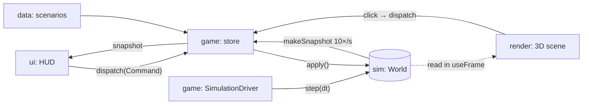

# Architecture

*Floodword* is a browser game: TypeScript, React, three.js through React Three Fiber, built with Vite.
The design rule that shapes everything: **the simulation is the game, and everything else is a view of it.**

## Layers

```
src/
  sim/      Pure TypeScript simulation. The source of truth. No React, three.js or browser APIs.
  data/     Scenarios and content (towns, routes, carriers, rumours). Plain data typed by sim/types.
  game/     The bridge: owns the World, runs the fixed-step loop, accepts commands, publishes snapshots.
  render/   React Three Fiber scene. Reads the World every frame; never changes it.
  ui/       React HUD. Reads snapshots; changes the world only by dispatching commands.
```



Import rules (`sim` is enforced by ESLint):

| Layer | May import |
|---|---|
| `sim` | only `sim` |
| `data` | `sim` types |
| `game` | `sim`, `data` |
| `render`, `ui` | `sim` (read-only helpers), `game` |

## Simulation rules

1. **Plain data.** `World` is JSON-serialisable: no classes, Maps, Sets or functions. Save/load,
   replays, debugging and analytics all depend on this.
2. **Deterministic.** All randomness comes from `nextRandom(world.rng)`. The same seed and command
   list always produce the same game, and `sim.test.ts` checks this.
3. **Fixed step.** `step(world, dt)` is called with a constant `dt` (0.05 game hours) by
   `SimulationDriver`, independent of frame rate.
4. **Commands are the only input.** The player affects the world only through
   `apply(world, command)`, which validates and returns `{ ok } | { ok: false, reason }`. The UI uses
   query helpers (`travelOptions`, `speakTargets`, `interceptTargets`) to show what's allowed,
   and those helpers use the same rules `apply` checks.
5. **Systems are functions.** Each system is a `stepX(world, dt)` function in its own file, called
   in a fixed order from `world.ts`. Add a system by writing the function and adding one line to `step()`.

## How the rumour model maps to the design

| Design (docs/design/01-game-brief.md §3.1) | Code |
|---|---|
| Rumour `{eventType, subject, truth, heat, origin, hops}` | `Rumour` (the event) + `RumourCopy` (one telling, which drifts) |
| Carriers are agents on the map | `Carrier` with a looping `schedule`; `carriers.ts` |
| Distortion per hop | `retell()`: chance = heat × 0.5; lowers truth, exaggerates stance |
| Interception | `intercept` command; must be within `INTERCEPT_RANGE_KM` on the same route |
| Visibility: unknown rumours stay hidden | `player.known`; filled by `observe()` in towns and near carriers |
| Town reputation = weighted beliefs | `reputation()` = Σ stance × confidence over claims about the player |
| First impressions (why racing matters) | `hear()`: an earlier contrary claim discounts a newcomer; false claims erode |

Milestone 1 keeps beliefs at **town** level. Milestone 2 replaces `TownState.claims` with per-NPC
beliefs and aggregates them, without changing the carrier or command code.

## Rendering and UI performance

- Moving things (carriers, the player) are updated in `useFrame` by reading `useGame.getState().world`
  directly. They don't re-render React every frame.
- The HUD subscribes to `snapshot`, which `SimulationDriver` rebuilds 10 times a second. Components
  select small slices of it with `useGame((s) => …)`.
- `SimulationDriver` pauses the game when a carrier comes into intercept range, or when the
  scenario ends, so a high game speed can't skip a decision.

## Testing

- `npm test` runs Vitest on `src/**/*.test.ts`. Simulation tests run headless, with no browser.
- Test gameplay rules as *scenarios* ("speaking first keeps a town on your side") as well as unit rules.
- `npm run check` runs typecheck, lint and tests together. Run it before every commit.

## Planned additions (see ROADMAP.md)

| Need | Plan |
|---|---|
| Dialogue | `inkjs` stories in `src/story/*.ink`, compiled at build time; ink variables bound to sim state through commands |
| Save/load | `JSON.stringify(world)` into `localStorage`, plus a version field and migrations |
| Analytics | Opt-in log of `{time, command}` plus checkpoint snapshots, sent in batches to an HTTP endpoint |
| Endings | Port `docs/design/tools/ending_sim.py` to `src/sim/endings.ts`, with a test that the distribution matches |
| Faction AI | `factions.ts` utility scoring each in-game day; factions create rumours like any other event |
| Desktop builds | Tauri wrapping the same `dist/` |
| Art | Low-poly glTF models from Blender, loaded with drei `useGLTF`, replacing the grey-box meshes |
