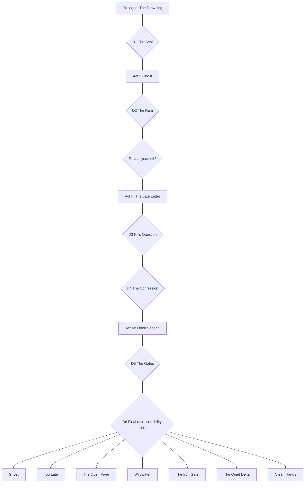

# Decisions and Endings

Six story decisions plus your systemic rumour play produce **7 endings**, and each ending has a
**Kit variant** that depends on whether you were honest with them. The logic is modelled in
[tools/ending_sim.py](tools/ending_sim.py), which enumerates every path. Re-run it whenever the
story changes.

---

## 1. The decisions

| # | When | Decision | Options | What it changes |
|---|---|---|---|---|
| D1 | Prologue | **The Seal** | Open it / Keep it sealed | Opening it unlocks blackmail in D2; keeping it sealed earns Postmaster Ione's respect, and in the finale she lends you the Post's fastest boat (reach 4 towns instead of 3) |
| D2 | Act I | **The Ram** (Sabe's offer) | Accept bribe / Refuse / Blackmail* | Credibility −1 / +1 / 0; Guild becomes owner / enemy / wary partner |
| — | End of Act I | **Reveal** (systemic) | Let the Delta know you're alive / stay hidden | Staying hidden is the only route to the secret ending |
| D3 | Act II | **Kit's Question** | Tell the truth / Lie | Decides the Kit variant of every ending |
| D4 | Act II | **The Confession** | Deliver as written / Alter (remove your name) / Burn / Sell to Guild / Sell to Lockwardens / Spread as rumour only | Credibility, how much truth goes public, faction power |
| D5 | Act III | **The Gates** | Lockwardens / Tidefolk / Guild / The Post (warn everyone) | Who controls the Delta afterwards |
| D6 | Finale | **The Order** (route of the final race) | Which towns you reach first | Which towns are saved, shown in the epilogue. It doesn't change the ending |

*Blackmail requires having opened the letter in D1.

**Towns saved** = the smaller of credibility and route length (3 towns, or 4 with Ione's boat).
D6 decides *which* towns those are, so each town's epilogue rumour depends on it.

**Credibility** (how many of the 5 standing towns believe your final warning) =
`2 + rumour skill (0–2) + D2 modifier + D4 modifier` (deliver as written +1; burn or sell −1).
This is the mechanical link between the whole game and the finale.

---

## 2. The endings

Conditions are checked **in this order**, and the first match wins.

| Order | Ending | Condition | What happens |
|---|---|---|---|
| 1 | **Ghost** *(secret)* | Stayed hidden through Act I *and* spread the confession only as rumour | You never come back to life. The warnings arrive by crow, unsigned. The Delta tells stories of a drowned courier who walks the river before every flood. You become a rumour. |
| 2 | **Too Late** *(failure)* | Credibility 0: no town believes you | Hollowmere happens again. You arrive with the warning and they laugh you out of the gate. The final shot mirrors the opening: you watching from the water. |
| 3 | **The Open River** | Delivered the confession as written, *and* sided with the Tidefolk or the Post | The full truth is read aloud in every town, your name included. Brann resigns, the gates are opened slowly, and the river is given room. You're stripped of the courier's oath and leave your satchel at the Post. Who picks it up depends on the Kit variant. |
| 4 | **Wildwater** | Sided with the Tidefolk (without full truth) | The old dikes are broken and the Delta is redrawn by the river. Saltmouth's warehouses flood, and the Guild falls. Free, poorer, wilder. Nobody is sure whether you were a hero. |
| 5 | **The Iron Gate** | Sided with the Lockwardens, *or* sold the confession to them, *or* sided with the Guild after the full confession went public | Brann turns Hollowmere into his argument: *never again, at any price*. If he holds the confession, it's his leverage. If the whole Delta has heard it, the Guild is disgraced and the Lockwardens fill the gap. Either way the gates become law. The Delta is safe, watched, and quiet. |
| 6 | **The Quiet Delta** | Sided with the Guild, *or* burned / sold the confession to the Guild, and the full confession never went public | Silence wins. You live comfortably in Saltmouth. The final scene: a letter arrives for you, one day late. |
| 7 | **Clean Hands** | Stood with the Post and altered the confession or spread it only as rumour | The truth comes out, without your name. You're celebrated as the courier who saved the Delta. Years later, someone finds Teodor's original copy. |

### Kit variants (applied on top of every ending)

| Variant | Condition | Final beat |
|---|---|---|
| **Kit stays** | Told Kit the truth (D3) | Kit forgives you, and the last rumour of the game is told in Kit's voice. In The Open River, Kit takes up your satchel. |
| **Kit leaves** | Lied to Kit, then the full confession went public | Kit hears your name read aloud in a town square. You never see them again. In The Open River, your satchel stays on its hook at the Post. |

A Kit variant's beat always replaces any Kit moment in the base ending, so the two can never contradict each other.
| **Kit never knows** | Lied, and your name never went public | Kit still idolises you. The game asks whether that's mercy or theft. |

---

## 3. Decision flow

---

## 4. Analysis: is the branching balanced?

The simulator enumerates all **1,440 valid paths**
(2 × 3 × 2 × 2 × 6 × 4 × 3 skill levels, minus blackmail paths where the letter was never opened).
This assumes every option is equally likely. Real players won't choose randomly,
but it's the standard first check that no ending is unreachable or dominant.
D6 isn't part of the count, because it shapes the epilogue rather than the ending.

**Targets:** every ending ≥ 3% (the same floor as the player analytics in §7 of the brief) and
no ending above **35%**, so that no ending feels like the default outcome.

### First draft of the rules (rejected)

| Ending | Share |
|---|---|
| The Quiet Delta | 29.0% |
| Too Late | 20.0% |
| The Iron Gate | 19.9% |
| Clean Hands | 12.6% |
| The Open River | 8.3% |
| Ghost | 8.3% |
| **Wildwater** | **1.8%** ✗ (below the 3% minimum) |

**What the data showed**: Wildwater was almost unreachable because other rules caught Tidefolk
paths first, and one in five random paths was a failure ending, which would make the game feel
punishing.

**Two fixes**:
1. **Allegiance decides the world's fate.** Siding with the Tidefolk now always reshapes the
   Delta (unless the full truth came out), and siding with the Lockwardens always leads to the Iron Gate.
   It's also better storytelling: breaking the dikes is a world-level event that one letter can't undo.
2. **Too Late only when no town believes you** (credibility 0 instead of < 2). Failure should come
   from consistently bad choices, not one weak decision.

### Second draft (rejected)

That version reached Iron Gate 28.5% and Quiet Delta 24.9%, but 60 paths delivered the full
confession publicly and then ended in "Silence wins" or "Brann uses the confession as leverage".
**Fix:** siding with the Guild after the full confession is public now leads to The Iron Gate (the
Guild is disgraced and the Lockwardens fill the gap), and the Iron Gate text works whether the
confession is public or not.

### Current rules

| Ending | Paths | Share | Check |
|---|---|---|---|
| The Iron Gate | 470 | 32.6% | ✓ under the 35% cap, but close. Watch this in playtests |
| The Quiet Delta | 298 | 20.7% | ✓ |
| Wildwater | 246 | 17.1% | ✓ |
| The Open River | 120 | 8.3% | ✓ deliberately harder: the "best" ending should be earned |
| Ghost | 120 | 8.3% | ✓ secret ending, rare by design |
| Too Late | 96 | 6.7% | ✓ |
| Clean Hands | 90 | 6.2% | ✓ |

All endings now fall between 6% and 33%.

**Towns saved in the final race** (epilogue): 0 towns 6.7%, 1 town 14.4%, 2 towns 25.6%,
3 towns 41.1%, 4 towns 12.2%. Saving 4 towns requires keeping the seal *and* high credibility. The two compromise endings (Iron Gate and Quiet Delta) are
the most common, which matches the theme: compromise is the easy path, and the honest one is hard.

### Design checks for every decision

A decision is only kept if it passes all four:

| Check | Meaning | D1 | D2 | D3 | D4 | D5 | D6 |
|---|---|---|---|---|---|---|---|
| **Visible** | The player knows they're choosing | ✓ | ✓ | ✓ | ✓ | ✓ | ✓ |
| **Costly** | Every option loses something | ✓ | ✓ | ✓ | ✓ | ✓ | ✓ |
| **Echoes** | The consequence is seen later, elsewhere | ✓ (D2 options, Ione's boat) | ✓ (credibility) | ✓ (Kit variant) | ✓ (ending) | ✓ (ending) | ✓ (epilogue: which towns survive) |
| **Not obvious** | No option is clearly "correct" | ✓ | ✓ | ✓ | ✓ | ✓ | ✓ |

### Content cost

7 endings × 3 Kit variants = 21 epilogue combinations, but each is built from a shared ending
scene plus a short Kit beat. That's **7 full scenes + 3 short beats**, not 21 scenes. This is the
same "layered variant" approach narrative studios use to multiply outcomes cheaply.

### Next analytical step

When the Act I demo ships, compare the **real** choice splits from playtest analytics with these
assumed-uniform numbers (see §7 of the brief). If, for example, 80% of players refuse Sabe's bribe,
the Quiet Delta becomes rarer in practice, and the rules may need adjusting.
